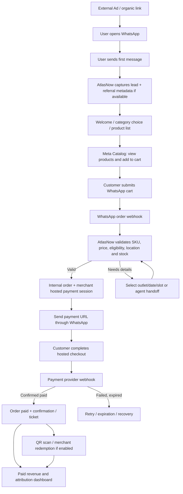
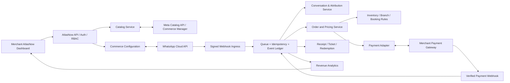

# AtlasNow — WhatsApp Commerce & Revenue Attribution
## Product Requirements Document (PRD) v0.1 — YOLA FUN Pilot

> [!warning] Belum mengalahkan keputusan yang sudah dikunci
> Status dokumen ini: **proposed**. Integrasi, kelayakan katalog, dan operasi merchant **belum live-tested**.
> Uang, paket, kredit WhatsApp, dan rail pembayaran: [[AtlasNow-Monetization-PRD]] menang sampai founder mengubahnya di situ. Jangan wire Xendit, Midtrans, atau Creem dari PRD ini. AtlasNow **bukan** merchant of record. Pembeli bayar ke gateway merchant.
> Nomor WhatsApp: [[AtlasNow-WhatsApp-Decision]] tetap berlaku — satu nomor HQ Cloud untuk blast, loyalty, dan inbox. Commerce di nomor yang sama butuh keputusan founder terpisah. Jangan kirim dari sesi cabang.
> App Meta live: jangan tambah permission `catalog_management` atau produk baru tanpa Joe yang publish.
> Cart WhatsApp **bukan** bukti bayar. `PAID` hanya dari webhook gateway yang terverifikasi.
> Harga SKU di contoh (termasuk Rp4.200.000) adalah **angka ilustrasi**, bukan harga jual dan bukan harga paket AtlasNow.

---

**Date:** 23 October 2026  
**Status:** Proposed / discovery-validated architecture; integrations, eligibility and merchant operations not yet live-tested  
**Product:** AtlasNow.co, *Local Revenue OS*  
**Working feature name:** **Boost Sales with WhatsApp Catalog**  
**Positioning:** *Turn conversations into measurable revenue.*  
**Primary users:** Merchant HQ/Admin, Branch Manager, Operations/Sales Agent, AtlasNow Super Admin

---

## 1. Executive decision

**Build:** A merchant-operated WhatsApp commerce control center within AtlasNow. Merchant connects its own Meta WhatsApp Business Account (WABA), WhatsApp Business phone number, Meta product catalog and merchant-owned payment provider. AtlasNow provides product administration/sync, an ad-to-WhatsApp lead journey, a WhatsApp shopping experience, backend order orchestration, hosted payment links, real-time payment confirmation, and branch-level revenue attribution.

**Do not build:** A replacement WhatsApp application, native WhatsApp payment processor, or an ad buying platform in MVP.

**Critical distinction:**
- **WhatsApp Catalog / Cart:** Meta-native browsing and cart submission within WhatsApp, where supported and enabled.
- **Order:** Customer submits cart; WhatsApp emits an order webhook. This is **not proof of payment**.
- **Checkout:** AtlasNow validates product and availability, creates internal order and merchant payment session, and sends a hosted checkout/payment link back in chat.
- **Paid:** Only confirmed on the trusted payment provider's authenticated webhook or a verified provider-side status lookup. Never mark PAID solely because the customer clicked the checkout link or returned from the payment page.
- **Fulfilment:** After payment, send confirmation and optionally a single-use ticket/voucher for in-store redemption.

**Key launch risks:** Meta catalog policy/product eligibility for admission or event-like tickets, Meta asset permissions and app review, actual WhatsApp API availability for intended catalog use, customer channel ownership, inventory/slot confirmation, and gateway settlement ownership.

---

## 2. Problem / opportunity

Merchant spend on ads drives conversations, but businesses often lose the trail between a conversation and an actual sale. Manual sales handling means slow replies, inconsistent product guidance, untracked orders, payment abandonment, and little evidence of which ad/outlet produced paid revenue.

**AtlasNow outcome:** Connect **acquisition signal -> conversation -> ordered products -> payment -> fulfillment/redemption -> revenue by branch**. Do not overclaim that WhatsApp views, conversations, or cart creations are sales.

### Goals
1. Enable a merchant to administer the Meta-linked catalog and commerce settings **from AtlasNow** once access is granted.
2. Convert a customer-initiated WhatsApp chat into a product/cart order and merchant-owned payment link.
3. Persist the buyer's WhatsApp contact identifier and optional consent for compliant future communications.
4. Attribute **paid** transactions to available ad referral data and selected branch, with clear unknown-source handling.
5. Give HQ, branch managers and agents permissioned access to conversion and revenue outcomes.
6. Keep the model extensible to Meta Ads, Google Ads, POS, booking, promotions and multi-location operations.

### Non-goals for MVP
- Building / managing ad campaigns from AtlasNow.
- Claiming checkout and payments remain entirely inside WhatsApp in Indonesia.
- Building a generalized CRM or autonomous AI agent.
- Automated physical foot-traffic measurement.
- Automated refunds and settlement / platform-held merchant funds.
- Full POS/booking/ticketing integration on day one.

---

## 3. Pilot merchant: YOLA FUN

Public site: https://www.yolafun.com/ — describes indoor family entertainment in Indonesia. The site does not establish a verified public ticket SKU, pricing, or booking inventory in the reviewed page. Pilot item names below are **hypothetical placeholders only**; merchant must approve SKU names, policies, pricing, available outlets and redemption workflow.

**Candidate test products (not verified merchant offers):**
- General play admission
- Family admission bundle
- Birthday / group inquiry package

**Recommendation:** For a simpler first test, start with fixed-price, fixed-entitlement packages rather than day-specific time-slot stock. Add location/date/slot selection via an AtlasNow interactive conversation/WhatsApp Flow only if confirmed necessary. For time-slot tickets, create a backend inventory reservation and expiry instead of trusting static catalog inventory alone.

**Policy gate:** Meta commerce policies apply to cataloged goods/services; ticket/event-like use cases may face restrictions depending on exact category and country. Submit a small test catalog and verify approval for the merchant's actual offering. If denied, fall back to an **information-first chat + external merchant-approved checkout** without presenting a restricted product as a purchasable WhatsApp catalog listing.

---

## 4. Primary customer journey



### End-user sample messages (illustrative only)
**Customer:** “Halo, saya mau lihat paket YOLA FUN.”  
**Auto-reply:** “Halo! Selamat datang di YOLA FUN. Mau lihat pilihan paket atau tanya ke tim kami?”  
**Customer selects product(s) in WhatsApp Catalog and submits cart.**  
**System:** “Pesanan kamu sudah kami terima. Konfirmasi lokasi dan tanggal dulu, ya. Total final akan muncul sebelum pembayaran.”  
**System after validation:** “Order YF-000123: [item × quantity]. Total Rp[amount]. Selesaikan pembayaran melalui tautan aman berikut: [merchant payment link].”  
**After trusted payment success:** “Pembayaran berhasil. Ini konfirmasi pesanan [ID]. [QR / redemption instructions], berlaku sesuai ketentuan yang tercantum.”

**User expectation warning:** Receiving a cart is not equivalent to a payment or completed checkout. Display accurate wording at every step.

---

## 5. Capability feasibility matrix

| Feature | From AtlasNow web admin? | Dependency / interpretation | MVP |
|---|---|---|---|
| Connect merchant WABA / number | Yes, onboarding/API-assisted | Business Meta asset ownership, approved permissions, review | Required |
| Select/link Meta catalog | Yes where permissions/API permit; may need one-time Meta UI step | Meta Commerce Manager + catalog-WABA relationship | Required |
| Create/edit product master records | Yes | AtlasNow data store | Required |
| Push product updates to Meta catalog | Yes | Catalog API/feed access with `catalog_management`, product approval | Required |
| Toggle catalog visibility/cart | Yes | `whatsapp_commerce_settings` per WhatsApp phone number | Required |
| Send single/multi-product/catalog messages | Yes | Cloud API, approved assets, session/template rules | Required |
| Receive submitted cart | Yes | Cloud API `order` webhook | Required |
| Customer selects outlet/date/slot | Yes, subject to design | Chat buttons/flows or merchant-hosted confirmation form | Conditional |
| Create dynamic external hosted payment link | Yes | Merchant-linked Xendit/Midtrans or equivalent | Required |
| Mark order paid automatically | Yes | Verified gateway webhook/status | Required |
| Store phone / create customer record | Yes, minimize use | Data policy, opt-in where needed | Required |
| In-WhatsApp native payment for Indonesia | **Not an MVP dependency** | Public Platform API payment support varies by geography; validate separately | Out |
| Merchant receipt/e-ticket and redemption | Yes | AtlasNow-generated voucher, or POS/ticketing integration | Pilot option |
| Direct ads creation/optimization in AtlasNow | Later | Meta Ads and/or Google Ads connectors | Phase 2 |

**Important:** The WhatsApp Business **app catalog** help page does not establish that a standalone app catalog can be fully managed through the **Cloud API**. This implementation must explicitly use a **Meta Commerce Manager catalog** linked to a Cloud API WABA.

---

## 6. AtlasNow navigation and user roles

### Suggested IA

**Data Health / Connections**
- WhatsApp Business: connect, permission diagnostics, WABA/phone number, webhook health, opt-out compliance, template status.
- Meta Catalog: connect/create (where permitted), linking status, last sync, sync errors.
- Payments: provider connect, sandbox/live flag, webhook verification, merchant settlement settings.

**Revenue > WhatsApp Commerce**
1. **Overview** — conversations, order rate, paid GMV, net revenue, paid conversion by source/outlet.
2. **Catalog** — SKU, content, images, pricing, active state, stock/slot rules, sync status.
3. **Sales Journeys** — welcome action, product collections, button/Flow options, follow-up rules.
4. **Orders & Payments** — operational order list, refunds, retries, payment timeline.
5. **Leads / Conversations** — contact, source, chat timeline, cart, agent handoff.
6. **Attribution** — source, ad ID, promo, paid sales, branch report.
7. **Vouchers / Redemption** (pilot optional) — generate, validate, redeem, reconcile.

### Permission model
| Role | Rights |
|---|---|
| HQ / Owner | Configure integrations, view all locations, approve catalog/promotion changes, all financial metrics |
| Branch Manager | View branch orders/attribution, manage branch availability, redeem, limited changes |
| Agent / Operator | View assigned chats, product assist, handle paid/unpaid customer support, redeem only if permitted |
| AtlasNow Super Admin | Tenant support, integration diagnostics, **no routine visibility into payment secrets or raw personal data** |

**Multi-location decision:** Pilot can use one merchant WhatsApp number and branch selection in checkout. Support separate numbers and optionally separate catalogs per branch later. Always record `location_id` on confirmed orders; do not assume the ad or entry phone number implies the purchasing branch.

---

## 7. Functional requirements (prioritized)

### P0-01 — Merchant connection and health
- Merchant selects/connects its Meta business assets and WhatsApp phone number.
- Capture `tenant_id`, Meta business ID, WABA ID, `phone_number_id`, catalog ID and permission scope in secure tenant-isolated storage.
- Connection test: read phone number, catalog link state, commerce settings, subscribed webhook status, send a test reply when permitted.
- Clearly distinguish **Not connected / Action required / Connected / Error / Suspended**.
- Provide secure disconnect and token invalidation behavior; logs redact secrets.
- Do not claim self-serve public multi-tenant onboarding is generally available without any Meta App Review/Business verification steps.

**Acceptance:** A valid test merchant connects; health checks pass; invalid permission and unlinked catalog show specific remediation.

### P0-02 — Catalog product manager
- Merchant CRUD for master SKU: SKU ID, title, description, image URL/media, currency, list price, promo price, active state, branch eligibility, terms and redemption type.
- Initial catalog sync uses Meta Catalog Batch API or a supported feed path, with per-item result recording, retry and review status.
- SKU is stable and maps uniquely to Meta `product_retailer_id` within the linked catalog.
- Price shown to customer is not authoritative for final charge; backend recalculates at checkout with current active SKU/pricing/promo/tax and obtains customer confirmation if it differs.
- Warn if Meta product listing is under review/rejected/out of sync; do not send unavailable products.
- For reservation-dependent products, backend owns slot availability, booking holds, and capacity.

**Acceptance:** Admin changes a test product in AtlasNow and sees successful remote sync or an actionable sync error. Invalid/out-of-stock SKU cannot become payable.

### P0-03 — WhatsApp commerce settings and product messaging
- Read and manage Meta `is_cart_enabled`, `is_catalog_visible` on the linked phone number.
- Send welcome + suggested categories/product list after a user-initiated chat.
- Support `interactive: product`, `interactive: product_list`, and catalog share/template where officially supported.
- Use WhatsApp free-form / interactive messaging only during the valid customer service window; use pre-approved templates for business-initiated/out-of-window messages.
- Ensure an agent-handoff option exists; avoid auto-reply loops and duplicate sends.

**Acceptance:** Customer can open the product list, add products to cart and submit an order that becomes an AtlasNow order.

### P0-04 — Lead and source attribution
- Record inbound WhatsApp contact identity, phone number normalized to E.164 (where available), conversation ID, first inbound timestamp, campaign/ad referral fields where supplied (`source_id`, `source_url`, `ctwa_clid`, etc.).
- Capture at the first user message, not merely ad click. Some referral fields may be absent due to availability, privacy choices or entry route.
- Attribution must include confidence flags: `verified_referral`, `tracked_link`, `manual_source`, `unknown`.
- Link source -> conversation -> order -> paid transaction; retain event timestamps and raw provider IDs securely for audit.
- **No claim of universal cross-platform attribution:** non-Meta ads need tracked WhatsApp entry links and may not carry source metadata into the WhatsApp conversation. Use a tracked landing/redirect and a correlatable prefill token where feasible; note prefilled text is editable and may never be sent.

**Acceptance:** Known Click-to-WhatsApp referral appears on a lead and on a paid-order report; no referral shows `unknown`, not misleading attribution.

### P0-05 — Order ingestion and checkout validation
- On WhatsApp `order` webhook, parse `catalog_id` and `product_items` including `product_retailer_id`, `quantity`, `item_price`, `currency`.
- Validate catalog and tenant mapping; read master SKU; reprice on server; enforce active/availability limits and applicable taxes/fees; select branch and visit date where needed.
- Maintain immutable `order_items` snapshot with unit price, quantity, tax, discounts and total.
- Generate internal order ID and exactly one active payable session per order version.
- Idempotent processing keyed by provider `wamid` / webhook event identity. Duplicate webhook must not create duplicate orders, tickets, payment links or charges.
- Display `ORDER_RECEIVED` as **not yet paid**.

**Acceptance:** Duplicate webhook creates a single order. Any price/stock conflict blocks payment and requests reconfirmation.

### P0-06 — Payment gateway
- **Integration strategy:** one direct payment gateway first, behind a provider abstraction. Candidate: Xendit Payment Sessions `POST /sessions` with `mode: PAYMENT_LINK`, or Midtrans Snap / Payment Links.
- Gateway merchant account and payouts belong to YOLA FUN; AtlasNow is orchestration/reporting software, not merchant of record.
- Gateway credentials stay encrypted server-side; never expose secret keys to browser, WhatsApp or messages.
- Create a short-lived hosted checkout URL bound to internal order ID and amount/currency; set expiry and reconcile with order reservation expiry.
- Send payment link in WhatsApp and show `PAYMENT_PENDING` in AtlasNow.
- Process signed/authenticated gateway webhook, re-fetch payment status where needed, commit `PAID` transaction atomically and idempotently.
- Expiry, failure, refund, duplicate callback, partial payment and chargeback must be reconciled as separate statuses/events.
- Use hosted provider checkout for QRIS, VA, e-wallet, cards **subject to merchant onboarding and enabled methods**.

**Acceptance:** Payment in sandbox triggers verified `PAID` in AtlasNow; manual browser redirect without gateway confirmation cannot do so; expiry and duplicate callbacks are safe.

### P0-07 — Merchant dashboard and audit
- Order table with lead source, branch, items, amount, payment, fulfillment and agent owner.
- Payment event timeline and gateway references; permissioned export to CSV.
- Differentiate order amount/GMV, paid gross sales, refunds, net paid revenue, actual redemption. Never silently equate catalog interest to revenue.
- Export metrics by date, branch, source and SKU; display source coverage percentage and spend attribution quality.

**Acceptance:** HQ sees all branches; Manager only authorized branch; paid numbers reconcile against test gateway records.

### P1-01 — Optional ticketing and redemption
- After PAID, create unique signed/opaque ticket or voucher per entitled unit (or bundle, configurable).
- QR contains a secure random reference, **not customer phone number or card information**.
- Staff scan in AtlasNow web UI, validate merchant/branch/validity/previous use and atomic single redemption.
- Support partial redemption only if product rules allow. Refund invalidates unredeemed tickets.

### P1-02 — Recovery & engagement
- Payment reminder and abandoned-cart recovery only where permitted by WhatsApp session/template/consent policies.
- Record explicit marketing opt-in separately from customer-initiated conversation or order processing.
- Allow opt-out; suppress promotional sends promptly.
- Human takeover for refund inquiries, disputes, booking changes and API failure.

### P2 — Integrations and campaign optimizer
- Ads campaign creation, budget, ad creative and deep-link integration with Meta Ads API.
- Google Ads linkage via tracked landing links/GA4/UTM when feasible; do not invent native WhatsApp referral attribution.
- Meta Conversions API for supported WhatsApp conversion events, subject to eligibility, consent, integration and event-deduplication requirements.
- Google Business Profile CTA/offer or QR/voucher journey as a channel with honest attribution boundaries.
- POS / booking / ticket validation / inventory synchronization.
- Multi-merchant billing/commission and settlement integrations only after legal/payment compliance review.
- WhatsApp Flows for real-time branch, date, visitor count and availability.

---

## 8. Recommended services / architecture



### Technology-neutral components
- **Web frontend:** Existing AtlasNow auth/tenant/layout; admin and branch RBAC.
- **Core API:** Multi-tenant gateway and authorized per-merchant operations.
- **Integration adapters:** `MetaCatalogAdapter`, `WhatsAppCloudAdapter`, `PaymentProviderAdapter`.
- **Inbound webhook worker:** Verify Meta `X-Hub-Signature-256` where applicable; verify payment-provider signatures; queue quickly, process asynchronously.
- **Relational data store:** Transactions and unique constraints; event-append table for audit; encrypted PII.
- **Queue:** At-least-once handling, retries and dead-letter queue; downstream handlers must be idempotent.
- **Analytics:** Materialized aggregates per day, merchant, branch, campaign/source.

**Deployment decision:** Avoid direct browser-to-Meta Graph API and browser-to-gateway calls. All privileged operations go via AtlasNow backend.

---

## 9. API touchpoints (references, not copy-paste production integration)

### Meta
- Send message: `POST https://graph.facebook.com/{GRAPH_API_VERSION}/{PHONE_NUMBER_ID}/messages`
- Query/update storefront: `GET/POST https://graph.facebook.com/{GRAPH_API_VERSION}/{PHONE_NUMBER_ID}/whatsapp_commerce_settings`
- Commerce flags: `is_cart_enabled=true`, `is_catalog_visible=true`.
- Catalog sync: Meta Commerce Catalog Batch API (e.g. `POST /{CATALOG_ID}/batch` for supported catalog type and API version); do not assume that Meta's deprecated or alternative endpoints have identical payloads.
- Subscribed app webhooks: `POST /{WABA_ID}/subscribed_apps` where applicable.
- Required permissions typically include WhatsApp management/messaging plus `catalog_management` for catalog CRUD, plus specific asset access; app review/advanced access may apply to third-party onboarding.

**WhatsApp order webhook excerpt — representative field shape, not complete payload:**
```json
{
  "messages": [{
    "from": "<CUSTOMER_PHONE>",
    "id": "<WHATSAPP_MESSAGE_ID>",
    "type": "order",
    "order": {
      "catalog_id": "<CATALOG_ID>",
      "product_items": [{
        "product_retailer_id": "PLAY-PACKAGE-001",
        "quantity": 2,
        "item_price": 100000,
        "currency": "IDR"
      }]
    }
  }]
}
```
Actual payload nesting is `entry[].changes[].value.messages[]`; store the raw event internally with retention and PII controls.

### Payment gateway
- **Xendit:** server creates `POST /sessions`, `mode: PAYMENT_LINK` for hosted checkout; use supported ID/country configuration and signed webhooks.
- **Midtrans:** Snap API for hosted checkout or Payment Link API; use notifications as authoritative, not return URLs.
- Abstract response to `{provider, external_payment_id, url, amount, currency, expires_at, status}`.

### Suggested AtlasNow private REST endpoints
- `POST /api/commerce/whatsapp/connect` — start/complete authorized merchant connection
- `GET /api/commerce/whatsapp/health` — connection/permissions/sync status
- `GET/PATCH /api/commerce/whatsapp/settings` — visibility/cart configuration
- `GET/POST /api/commerce/catalog/products` — master SKU list/create
- `PATCH /api/commerce/catalog/products/:id` — update product
- `POST /api/commerce/catalog/sync` — push/schedule Meta sync
- `GET/POST /api/commerce/journeys` — rules and selected catalog entry
- `GET /api/commerce/orders` — filtered scoped order list
- `GET /api/commerce/orders/:id` — order state and payment audit
- `POST /api/commerce/orders/:id/payment-session` — server-side authenticated retry if eligible
- `POST /api/webhooks/meta/whatsapp` — Meta signed webhook receiver
- `POST /api/webhooks/payments/:provider` — provider-specific authenticated receiver
- `POST /api/commerce/redemptions/validate` and `/redeem` — pilot add-on
- `GET /api/commerce/analytics/funnel` — permissioned metrics

Require auth, tenant scoping, rate limiting, idempotency keys for write actions and structured audit logs.

---

## 10. Recommended data model

**`tenants`** `(id, display_name, status)`  
**`locations`** `(id, tenant_id, label, business_address, status)`  
**`wa_channels`** `(id, tenant_id, waba_id, phone_number_id, masked_number, integration_status, scopes, catalog_id)`  
**`meta_catalogs`** `(id, tenant_id, external_catalog_id, link_status, last_synced_at)`  
**`products`** `(id, tenant_id, sku, title, currency, unit_price, promo_price, kind, active, policy_status)`  
**`catalog_items`** `(id, tenant_id, product_id, meta_product_retailer_id, meta_item_id, sync_status, rejection_reason)`  
**`product_location_rules`** `(product_id, location_id, availability_mode, capacity_rule)`  
**`inventory_holds`** `(id, tenant_id, product_id, location_id, slot_at, quantity, expires_at, status)`  
**`contacts`** `(id, tenant_id, wa_id, phone_encrypted, phone_last4, privacy_notice_version, marketing_opt_in_at, opt_out_at)`  
**`conversations`** `(id, tenant_id, channel_id, contact_id, first_inbound_at, last_inbound_at, assigned_user_id)`  
**`attribution_touches`** `(id, tenant_id, conversation_id, source, source_id, ctwa_clid_encrypted, evidence_type, touched_at)`  
**`wa_messages`** `(id, tenant_id, conversation_id, provider_message_id, direction, type, sent_at, status)`  
**`orders`** `(id, tenant_id, contact_id, conversation_id, location_id, origin_wa_message_id, order_status, gross_total, net_total, currency, created_at)`  
**`order_items`** `(id, order_id, product_id, sku_snapshot, unit_price, qty, tax_amount, discount_amount, line_total)`  
**`payments`** `(id, tenant_id, order_id, provider, provider_reference, payment_url_redacted, amount, currency, payment_status, paid_at)`  
**`payment_events`** `(id, payment_id, provider_event_id, normalized_status, received_at, raw_event_ref)`  
**`vouchers`** `(id, tenant_id, order_id, location_id, opaque_token_hash, valid_until, redemption_status)`  
**`redemptions`** `(id, voucher_id, location_id, staff_id, redeemed_at)`  
**`webhook_inbox`** `(id, provider, external_event_id, tenant_id, received_at, processing_status, error)`  
**`audit_logs`** `(id, tenant_id, actor, action, object_type, object_id, created_at, metadata)`

**Constraints:** `UNIQUE(tenant_id, provider_message_id)` where applicable; unique processed provider webhook IDs; unique active reservation per product/slot rules; one paid transition per external payment; never index raw phone into tenant-agnostic search. Encrypt sensitive fields at rest and store tokens in a secrets manager.

---

## 11. State machines and reconciliation

### Business order state
`NEW -> ORDER_RECEIVED -> VALIDATING -> AWAITING_DETAILS (optional) -> PAYMENT_PENDING -> PAID -> FULFILLED -> REDEEMED`.

Failure / parallel flags: `CANCELLED`, `EXPIRED`, `PAYMENT_FAILED`, `REFUNDED`, `PARTIALLY_REFUNDED`, `DISPUTED`, `NEEDS_AGENT`.

**Do not conflate payment and fulfillment:** payment status is its own state; redemption status is its own state, enabling refunds and partial redemption.

### Recovery cases
| Case | Required behavior |
|---|---|
| WhatsApp webhook duplicate/out of order | Unique IDs + event ledger; no duplicate order |
| User submits stale cart price | Backend reprices, prompts confirmation, cannot auto-charge mismatched total |
| Product unavailable | Reject order / propose alternative / no payment link |
| User needs visit time | Validate time and capacity before creating payable checkout |
| Customer closes gateway browser | Keep `PAYMENT_PENDING`; reconcile with provider |
| Payment callback duplicates | Idempotent paid transition; only one ticket issuance |
| Payment confirmed after order expiry | Mark exception; no automatic release or overbooking; agent/refund flow |
| Send confirmation fails | PAID remains PAID; retry notification safely |
| Gateway temporarily down | Retry with backoff, staff handoff if needed |
| Refund occurs | Net revenue adjustment, ticket invalidation, auditable reason |
| Merchant disconnects number | Pause outgoing sends; preserve historical order/financial records as policy requires |

---

## 12. Attribution and metric definitions

### Event names
`lead_created`, `referral_captured`, `catalog_message_sent`, `cart_submitted`, `order_validated`, `checkout_link_created`, `checkout_link_sent`, `payment_confirmed`, `payment_failed`, `order_expired`, `ticket_issued`, `ticket_redeemed`, `refund_confirmed`.

### Funnel denominators
- **Inbound leads:** unique WhatsApp contacts with first inbound in period; not ad clicks.
- **Order conversion:** validated checkout orders / inbound leads, by cohort.
- **Paid conversion:** unique PAID orders / inbound leads, by cohort.
- **Checkout conversion:** paid orders / payment-link-created orders, by cohort.
- **Paid GMV:** sum of paid order captured amount before refunds/chargebacks; specify fees/taxes separately.
- **Net attributable revenue:** paid sales minus confirmed refunds/chargebacks, among orders meeting source attribution rule.
- **Redemption rate:** eligible redeemed tickets / issued eligible tickets.
- **Attributed revenue coverage:** paid revenue carrying traceable source evidence / total paid revenue.
- **Cost per acquired customer and ROAS:** show only when campaign spend is accurately imported or explicitly labeled manual/unverified.

### Recommended attribution rules
- Store all available touches rather than overwriting on every new message.
- MVP default for operational view: **latest eligible known inbound source within 7 days before order**, with the window configurable, clearly defined and never presented as causal proof.
- `source = unknown` when entry provenance cannot be validated; `source = direct_or_unattributed` for generic links without persisted valid source.
- `ctwa_clid` is an optional technical key, not always available. No PII-based cross-device matching as a default.
- If spend is unavailable, **do not show ROAS**; show paid revenue and attributed orders instead.

### Example dashboard (all numbers mock; not merchant actuals)
| Metric | Example |
|---|---:|
| Inbound WhatsApp leads | 100 |
| Submitted carts | 36 |
| Validated checkout orders | 30 |
| Confirmed paid orders | 21 |
| Checkout conversion | 70% |
| Paid sales (example only) | Rp4,200,000 |
| Branch attribution | Assigned by actual selected/fulfilled branch |

**Example calculations:** 21/30 = 70% checkout conversion. These are illustrative test numbers, not sales claims.

---

## 13. Merchant onboarding SOP (pilot)

1. Confirm legal merchant, outlet(s), actual product/package names, return/refund rules, tax treatment and whether dated booking/inventory is needed.
2. Review eligibility for Meta Catalog and WhatsApp commerce of those products/services; create a minimal test Meta catalog; verify product review/approval.
3. Obtain merchant consent and properly delegated access to Meta business portfolio, WABA, phone, catalog; complete platform app review/permission/embedded signup prerequisites as required.
4. Link catalog and phone; enable catalog/cart settings; send/receive test product message.
5. Configure AtlasNow merchant account, user roles, branch master, source mapping, privacy notice and opt-in rules.
6. Connect merchant-owned payment gateway account in sandbox; register signed webhook; test paid/failed/expired cases.
7. Upload 3 approved test SKUs; sync to Meta; verify product images, prices, currency and cart submission.
8. Test Click-to-WhatsApp ad referral (or tracked link), new contact, order webhook, payer redirect, signed payment confirmation, reporting and manual handoff.
9. Enable live gateway only after compliance and reconciliation acceptance; set operational support owners and error alerts.
10. Review results daily for pilot: lead-to-order conversion, order-to-paid conversion, payment failures, unknown attribution, outstanding fulfillment/redemption.

### Hard go/no-go gates
- Actual pilot products approved/allowed for the selected Meta catalog use case.
- Merchant WABA/catalog/phone connection healthy and permitted.
- Merchant gateway live account approved and merchant receives proceeds directly.
- Payment webhook validated and no duplicate charges/fulfillment on replay.
- Customer refunds/cancellation/consumer information and privacy notice in place.
- Human takeover available for support and edge cases.

---

## 14. Acceptance tests (E2E pilot)

**AT-01 Connectivity:** Valid WABA + number + catalog connect and health displayed; revoked permission triggers `Action required`.

**AT-02 Catalog:** 3 permitted pilot SKUs added in AtlasNow; each maps to one Meta retail ID and correct catalog, with sync status visible.

**AT-03 Commerce:** An end-user sends inbound message, receives supported product/catalog response, and submits a cart; order webhook linked to correct tenant/contact.

**AT-04 Pricing:** Alter price between catalog display and order. System requotes the actual approved price and never silently charges stale amount.

**AT-05 Conversion:** Validated order creates gateway-hosted link; payment confirmation arrives by authenticated callback and marks PAID once.

**AT-06 Safety:** Duplicate WhatsApp webhook and duplicate gateway webhook don't duplicate payment/order/ticket.

**AT-07 Unknown referral:** A lead without referral fields is labeled unknown; no fabricated ad campaign.

**AT-08 Known referral:** Real Click-to-WhatsApp referral linked to paid order with traceable source evidence.

**AT-09 Session:** Outside permissible 24-hour chat window, engine uses an approved template or does not send; marketing opt-out respected.

**AT-10 Permissions:** Branch manager cannot read unrelated branch financial/contact data.

**AT-11 Fulfillment (optional):** One paid order creates a QR; first valid scan redeems, second scan rejects.

**AT-12 Cancellation:** Expired booking hold or refund reconciles correctly with revenue and redemption.

### Pilot quality bar
- Zero duplicate charges, double-issued vouchers or cross-tenant data leaks.
- 100% of verified payment webhook events reconciled to one merchant order or flagged exception.
- 100% of paid orders carry location assignment or an explicit unresolved-location exception.
- No transaction marked PAID based on buyer screenshot or redirect alone.

---

## 15. Security, privacy and compliance

- Merchant authorization and least-privilege asset access; preserve merchant ownership of Meta, WhatsApp and payment accounts.
- Validate Meta webhook signature, payment webhook authenticity; protect against replay, forged amounts and order-ID enumeration.
- Use encrypted token/credential storage, tenant isolation, RBAC, rate limiting, audit trail, restricted raw-webhook access.
- Never log payment credentials, card information, unrestricted checkout URLs or raw customer PII in analytics.
- WhatsApp phone is personal data: publish valid privacy notice, define lawful purpose, retention and deletion request mechanisms in accordance with applicable Indonesian Personal Data Protection law.
- Service conversation ≠ blanket marketing consent. Track separate promotional opt-in; enforce opt-out.
- Approved templates and 24-hour session window rules; automated flows must provide clear human escalation.
- Commerce policies may restrict products/services; test eligibility before promising merchant checkout.
- Treat Meta message tariffs, BSP fees, payment processing fees and AtlasNow platform fees as separate cost lines. Verify latest Indonesia Meta rate cards at launch. Meta announced service-message billing changes effective October 2026; do not use obsolete free-service pricing assumptions.

---

## 16. Build phases and backlog

### Phase 0 — Feasibility Spike (hard blocker validation)
- Merchant actual SKU/policy approval test.
- Meta test WABA + product catalog + cart webhook using current Graph API version.
- Test merchant payment provider sandbox session and verified payment callback.
- Test CTWA referral capture with a legitimate campaign.
- Decide whether dated tickets must be in catalog, WhatsApp Flow or hosted form.

**Exit:** end-to-end manual happy path proven with real WhatsApp end-user and sandbox payment, plus policy eligibility.

### Phase 1 — MVP Core
- Tenant/Meta connection and Data Health.
- Catalog manager + Meta sync + commerce toggle.
- WhatsApp messaging + webhook ingestion + lead attribution.
- Order validation + payment link + payment callback.
- Minimal dashboards, roles, logs and refunds/expiry exception queue.

**Exit:** audited PAID revenue by contact, source evidence and branch on one pilot merchant.

### Phase 1.1 — Pilot operations
- QR voucher/redemption for selected items.
- Human handoff, exceptions list, stock/booking hold as required.
- Checkout reminder templates with opt-in/compliance checks.

### Phase 2 — Scale
- Multiple merchants, channels and outlets with agency/billing controls.
- Ads management/optimization and stronger first-party attribution.
- POS/booking integrations, advanced flow personalization, Meta conversion feedback.
- Configurable commissions, subscription pricing and consolidated HQ reporting.

---

## 17. Commercial model hypothesis

**Pilot:** fixed onboarding/integration fee + monthly AtlasNow software/managed fee. **Optional:** outcome-based fee per confirmed net paid order, if contractually defined and measured from gateway data; exclude refunded orders and define settlement/reconciliation period.

**Payment flows:** Buyer pays **YOLA FUN merchant gateway** directly, AtlasNow does not act as custodian of user funds. Any marketplace split settlements or platform merchant-of-record arrangement is a separate legal/payment-provider scope.

**Sales framing:**
> “Ads bring demand, WhatsApp makes buying easier, and AtlasNow proves which conversations actually turn into paid orders and revenue per outlet.”

---

## 18. Product questions to resolve with merchant during pilot onboarding

These do **not block the architectural PRD** but determine concrete configuration and eligibility:
- Does YOLA FUN sell entry tickets, fixed sessions, birthday packages, or require advance reservations?
- Are all branches covered by one WhatsApp number, or does each branch have a dedicated number?
- Which exact SKUs/terms are eligible for Meta Catalog commerce review?
- Which gateway does merchant already use and is live onboarding available?
- Is QR redemption required for on-site visit, and does a POS/ticketing system already exist?
- Are there per-date/per-location capacities or visitor-age pricing constraints?
- Who will own human escalation, customer support and refund decisions?

---

## 19. Source references / verification log (as of 23 October 2026)

1. WhatsApp Help Center — **About catalog** (app catalog behavior; distinct from Cloud API): https://faq.whatsapp.com/405903568419894/
2. Meta/WhatsApp business platform features: https://whatsappbusiness.com/products/business-platform-features/
3. Meta WhatsApp Business Platform Cloud API official Postman collection (contains order webhook and subscribed app examples): https://www.postman.com/meta/whatsapp-business-platform/documentation/wlk6lh4/whatsapp-cloud-api
4. Meta Official Postman **Commerce settings**: https://www.postman.com/meta/whatsapp-business-platform/request/30lrpw8/set-or-update-commerce-settings
5. Meta Commerce catalog API reference: https://developers.facebook.com/documentation/ads-commerce/commerce-platform/catalog/get-started
6. Meta Commerce Catalog Batch API: https://developers.facebook.com/documentation/ads-commerce/commerce-platform/catalog/batch-api
7. WhatsApp Business Messaging Policy (updated September 23, 2026): https://whatsappbusiness.com/id/policy/
8. WhatsApp Business Platform pricing: https://whatsappbusiness.com/id/products/platform-pricing/
9. WhatsApp Business Platform FAQ / billing changes: https://whatsappbusiness.com/id/resources/faq/
10. Xendit Payment Sessions create-session reference (updated October 13, 2026): https://docs.xendit.co/apidocs/create-session
11. Xendit Payment Link migration: https://docs.xendit.co/docs/migrate-to-payment-session
12. Midtrans Snap hosted checkout API: https://docs.midtrans.com/reference/snap-api-overview
13. Midtrans hosted Payment Link API: https://docs.midtrans.com/docs/payment-link-via-api
14. AWS dynamic WhatsApp Flows announcement (September 14, 2026): https://aws.amazon.com/about-aws/whats-new/2026/09/aws-end-user-messaging-whatsapp-dynamic-flows/
15. Third-party technical reference on Click-to-WhatsApp referral fields: https://docs.cm.com/messaging/business-messaging/incoming-messages/whatsapp-inbound
16. Third-party platform WhatsApp payments overview; regional API limitations require further provider validation: https://www.infobip.com/docs/whatsapp/whatsapp-payments
17. Public merchant website: https://www.yolafun.com/

### Verification notes
- Official Meta developer pages can be gated or rate-limited from unauthenticated browsing; exact Graph API payloads/scopes/version and product eligibility must be reverified in the connected developer app before production.
- The user's referenced WhatsApp catalog help page describes the **WhatsApp Business app** catalog. The PRD uses **Cloud API + Meta Catalog**, not an unsupported promise to edit the app-native catalog via third-party API.
- One WhatsApp consumer Help Center listing mentions paying registered businesses in Indonesia, while platform-API provider documentation describes in-conversation native payment features chiefly in India/Brazil. The production-ready recommendation therefore deliberately depends on **external merchant gateway payment links** in Indonesia, not an unsupported blanket claim about all consumer WhatsApp payment products.
